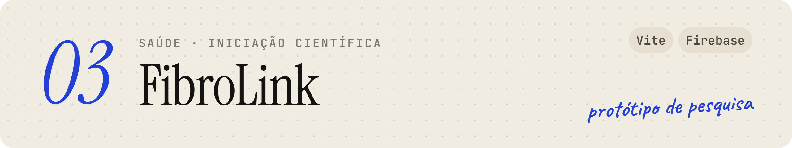
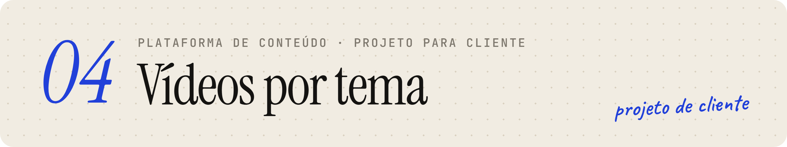

<a href="https://brenosilva.vercel.app">
  <picture>
    <source media="(prefers-color-scheme: dark)" srcset="assets/banner-dark.png">
    
  </picture>
</a>

 

Sou graduando em **Ciência da Computação na Universidade Federal de Sergipe** e desenvolvo **sites, aplicativos e sistemas sob medida** para autônomos e pequenos negócios — da conversa sobre o problema até o sistema publicado.

Uso inteligência artificial no meu processo para construir mais rápido e com menos custo. Entender o problema, decidir a arquitetura e garantir que tudo funciona continua sendo trabalho meu.

 

### ✦ &nbsp;Projetos

<a href="https://sanjes-obras.vercel.app/login">
  <picture>
    <source media="(prefers-color-scheme: dark)" srcset="assets/sanjes-dark.png">
    
  </picture>
</a>

Cronograma, produção, recursos e suprimentos de várias obras em um só lugar, conectando o planejamento à execução — do canteiro ao financeiro. &nbsp;[**Acessar o sistema ↗**](https://sanjes-obras.vercel.app/login)

 

<a href="https://linkosocial.com">
  <picture>
    <source media="(prefers-color-scheme: dark)" srcset="assets/linko-dark.png">
    
  </picture>
</a>

Uma rede social de recomendações de filmes, séries, livros, jogos e músicas em que cada indicação vem com opinião, nota e contexto. Feeds, listas, comentários e importação de bibliotecas do Letterboxd e da Steam. &nbsp;[**linkosocial.com ↗**](https://linkosocial.com)

 

<a href="https://fibromind.web.app/login">
  <picture>
    <source media="(prefers-color-scheme: dark)" srcset="assets/fibrolink-dark.png">
    
  </picture>
</a>

O paciente com fibromialgia registra dor, sono, fadiga e humor em poucos segundos, e o profissional responsável acompanha a evolução entre as consultas. Desenvolvido em um projeto de iniciação científica. &nbsp;[**Ver o protótipo ↗**](https://fibromind.web.app/login)

 

<picture>
  <source media="(prefers-color-scheme: dark)" srcset="assets/videos-dark.png">
  
</picture>

Uma plataforma mobile-first que organiza uma série de vídeos curtos por assunto, com página própria para cada tema, vídeos relacionados e QR codes para materiais impressos. Projeto de cliente, sem link público.

 

### ✦ &nbsp;Com o que eu trabalho

<picture>
  <source media="(prefers-color-scheme: dark)" srcset="https://skillicons.dev/icons?i=js,nextjs,vite,astro,firebase,vercel,java,c&theme=dark">
  
</picture>

JavaScript · Next.js · Vite · Astro · Firebase · Vercel &nbsp;—&nbsp; e Java e C na faculdade.

 

### ✦ &nbsp;Vamos conversar

Tem um problema que poderia virar uma ferramenta? Me conta.

[**Portfólio ↗**](https://brenosilva.vercel.app) &nbsp;·&nbsp; [**LinkedIn ↗**](https://www.linkedin.com/in/breno-silva-215442307) &nbsp;·&nbsp; [**devbrenosilva@gmail.com**](mailto:devbrenosilva@gmail.com)
